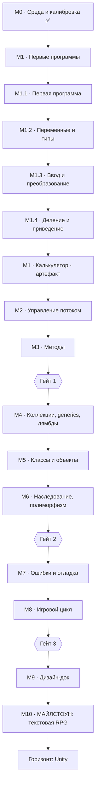

# C# → текстовая RPG: дорожная карта

> **Статус:** зафиксирована 26.10.2026 · обновлена 26.10.2026 (калибровка пройдена, М1 раздроблен)
> **Живой прогресс:** `progress.md` · **Идеи в сторону:** `parking.md`
> Этот файл — спецификация. Прогресс в него не пишется. Меняется только по согласию.

---

## Brief — блок для восстановления контекста

> Скопируй этот блок целиком, если сессия потеряла контекст.

```
Я учу C# с нуля. Конечная цель — самостоятельно делать 3D-игры на Unity
(ориентир по духу проекта — Voices of the Void). Текущая цель — майлстоун:
текстовая RPG в консоли на C#.

Формат работы: я пишу код сам. Ты — репетитор и контролёр знаний.
Не пишешь код за меня, даёшь наводящие вопросы и разбор ошибок.
Помощь ИИ разрешена для объяснений и ревью, запрещена для кода,
который я не могу объяснить построчно.

Проверка темы — три фильтра, нужны все три:
1) код работает и я объясняю каждую строку;
2) объясняю концепт своими словами (не только «как», но и «почему»);
3) переношу навык на новую задачу без подсказок.

Главное правило: один кодовый модуль в работе. Следующий не открывается
до зачёта текущего. Модуль не зачётся — дробится, а не шлифуется.

Мой риск: склонен хвататься за всё сразу и бросать, если не получается быстро.

Мой стартовый уровень (калибровка 26.10.2026): 2 из 10 устных, 0 из 3 задач.
Пишу код на C# с абсолютного нуля. Опора на Python местами мешает.

Актуальный модуль и журнал — в progress.md.
```

---

## Принципы

1. **Один кодовый модуль в работе.** Следующий не открывается до зачёта текущего.
2. **У модуля есть артефакт.** Модуль без работающего кода не существует.
3. **Порядок задан зависимостями**, не удобством.
4. **Модуль закрывается по критериям зачёта, не по ощущению.** Не даётся зачёт — дробишь модуль, а не шлифуешь его дальше.
5. **Дизайн-док пишется один раз и перед задачей**, к которой он относится. Не переписывается по ходу.

## Правила ресёрча и помощи

**Источники:** документация Microsoft Learn и Unity → Stack Overflow для сообщений об ошибках → видео и статьи как объяснение концепта, не как источник кода.

**ИИ можно:** объяснения, ревью твоего кода, разбор ошибки.
**ИИ нельзя:** вставлять код, который не можешь объяснить построчно. Проверка: прошу объяснить любую строку — объяснение должно быть без «оно как-то работает».

---

## Результат калибровки (26.10.2026)

| Ось | Результат |
|---|---|
| Среда и репозиторий | Настроено, работает |
| Устные вопросы | 2 из 10 (вопрос 1 угадан с сомнением, вопрос 10 верный) |
| Задачи A / B / C | 0 из 3 — кода нет |

**Вывод:** старт с абсолютного нуля по C#. Модули не вычёркиваются, но М1 дробится на четыре шага.

Отдельно зафиксированные проблемы, которые будет ловить каждый модуль:

- **Узнавание ≠ воспроизведение.** Концепты опознаются в чужом коде, но не пишутся с нуля. Это и есть разница, которую мы будем устранять.
- **Python-интуиция мешает.** `5 / 2` → ждём `2.5`, получаем `2`. В C# тип результата задаётся типами операндов, а не ожиданием.
- **`null` понимается как «пустая строка».** В C# это отсутствие объекта, и обращение к его членам — падение с `NullReferenceException`.

---

## Структура репозитория

```
CSharp_From_Scratch_To_TextRPG/
├── roadmap.md          ← эта карта
├── progress.md         ← статусы и журнал
├── parking.md          ← идеи в сторону
├── .gitignore
└── modules/
    ├── m00-calibration/
    │   └── Base_Console_App/
    └── m01-types/
        └── ...
```

**Ветки:** `Module_<NN>` → работа → мёрж в `main` после зачёта. Ветку после мёржа удалять.
**Коммиты:** `M1.2: переменные и типы` — модуль в начале сообщения.
**Не попадает в git:** `bin/`, `obj/` (проверено, что `.gitignore` работает).

---

## Карта зависимостей



---

## М0. Среда, репозиторий, калибровка — ЗАКРЫТ 26.10.2026

**Сделано:** репозиторий `CSharp_From_Scratch_To_TextRPG`, три файла и `.gitignore`, консольный проект в `modules/m00-calibration/`, сборка и запуск из VS Code, точка останова, первый коммит.

**Термины, которые ввели по ходу:**
- `.sln` — solution, файл-группа проектов. Формат `.slnx` — новый XML-вариант, для Unity и совместимости берём `.sln`.
- Точка останова приостанавливает выполнение **перед** строкой, а не обрывает программу. Дальше — Continue / Step Over / Step Into и панель переменных.
- `dotnet new gitignore` создаёт `.gitignore` с исключениями для C#.

**Конспект устных вопросов** (что было неверно — важно не забыть):
1. `5 / 2` → `2`, потому что `int / int` даёт `int`.
2. `null.Length` → падение с `NullReferenceException`, не пустая строка.
3. `var` — не динамическая типизация; тип выводится один раз и фиксируется.
4. `Parse` бросает исключение, `TryParse` возвращает `false`. Пользовательский ввод — только `TryParse`.
5. `while` проверяет до, `do-while` после. Второй — когда тело должно выполниться хотя бы раз.
6. `int` копируется, `List<T>` передаётся по ссылке.
7. Класс — чертёж, объект — экземпляр. `class` — ссылочный тип, `struct` — значимый.
8. `static` — принадлежит типу, а не экземпляру.
9. `NullReferenceException` — обращение к члену `null`-ссылки.
10. Иерархия источников: Microsoft Learn → Stack Overflow → статьи. Верный ответ.

**Что осталось на будущее:** отладчик по-настоящему (шаги, стек вызовов) — это М7. Сейчас достаточно уметь ставить точку и запускать F5.

---

## М1. Первые программы (раздроблен)

Цель модуля: уметь написать программу без подсказок, которая получает данные, хранит их в типизированных переменных и печатает результат.

### М1.1. Первая программа

- Структура файла: `using`, `namespace`, `class Program`, `static void Main(string[] args)`
- `Console.WriteLine` / `Console.Write`, что такое строка в кавычках
- `Ctrl+F5` vs `F5`, отладчик

**Артефакт:** программа выводит три строки о себе, запускается из отладчика, точка останова срабатывает.
**Зачёт:** объясняешь, что делает каждая строка шаблона, и почему `Main` именно такой.
**Мимо цели:** не можешь назвать, с какой строки начинается выполнение.

### М1.2. Переменные и типы

- `int`, `double`, `string`, `bool`, `char`
- Объявление, присваивание, изменение значения
- Конкатенация `+` и интерполяция `$"...{x}..."`
- `const`

**Артефакт:** программа хранит имя, возраст, рост и признак «студент» в переменных разных типов и печатает их одной интерполированной строкой.
**Зачёт:** называешь тип для каждой переменной и объясняешь, почему именно он; разница `int` и `double`.
**Мимо цели:** всё хранится в `string`; переменные объявлены, но не используются.

### М1.3. Ввод и преобразование

- `Console.ReadLine` **всегда** возвращает `string`
- `int.Parse`, `TryParse`, `Convert.ToInt32`
- Почему нельзя сложить `string` и `int` без преобразования

**Артефакт:** программа спрашивает имя и возраст, печатает `Привет, <имя>! Тебе <возраст> лет.` Возраст корректно приводится к числу.
**Зачёт:** объясняешь, почему `ReadLine` возвращает строку; сам выбрал между `Parse` и `TryParse` и обосновал.
**Мимо цели:** падает при вводе буквы в возраст.

### М1.4. Деление и приведение типов

- `5 / 2` → `2`, и почему
- `5.0 / 2`, `(double)5 / 2`, `Convert.ToDouble`
- Оператор `%` (остаток)
- Приоритет и порядок вычислений

**Артефакт:** программа делит два числа правильно (получает дробный результат) и отдельно выводит остаток от деления.
**Зачёт:** на листе бумаги предсказываешь результат пяти выражений до запуска; совпало — зачёт.
**Мимо цели:** продолжает ждать `2.5` от `5 / 2`.

### М1. Общий артефакт: калькулятор

Четыре операции, валидация ввода, не падает ни на буквах, ни на пустой строке, ни на делении на ноль.

**Зачёт:** работает; объясняешь каждое преобразование типа; сам нашёл и решил деление на ноль.
**Мимо цели:** падает на буквах; `var` везде, включая неочевидные места.

---

## М2. Управление потоком

`if`/`else if`, тернарный · `switch` и switch-выражения · `for`/`while`/`do-while`/`foreach` · `break`/`continue` · область видимости

**Артефакт:** «угадай число» — меню, лимит попыток, подсказки, повтор без перезапуска.
**Зачёт:** отличаешь `while` от `do-while` и говоришь, где нужен какой.
**Мимо цели:** меню через `goto`; вечный цикл на нечисловом вводе.

---

## М3. Методы

Параметры, возврат, `void` · перегрузка · `ref`/`out`/`in` · значения по умолчанию, именованные аргументы, `params` · стек вызовов · рекурсия как концепт (одна задача)

**Артефакт:** «угадайка» переписана на методы, ни один метод не длиннее 20 строк; добавлен настраиваемый диапазон.
**Зачёт:** объясняешь, зачем дробить на методы, кроме «так чище»; понимаешь, что будет при бесконечной рекурсии.

### Гейт 1
Процедурная программа на 100–150 строк без подсказок.

---

## М4. Коллекции, generics, лямбды

Массивы: границы, `Length`, `IndexOutOfRange` · `List<T>`, `Dictionary<K,V>` — когда что · что такое generic-тип на уровне «параметр типа» · `foreach` vs индексация · лямбда-выражение как аргумент

**Артефакт:** менеджер инвентаря — добавление, удаление, поиск по имени, сортировка, суммарная стоимость.
**Зачёт:** выбираешь `List` или `Dictionary` и обосновываешь; читаешь `List<Item>` как «список предметов», а не как магию.

---

## М5. Классы и объекты

Класс vs объект, `class` vs `struct` · поля, свойства (автосвойства, `get`/`set`) · конструкторы, `this` · модификаторы доступа, инкапсуляция · `static` · `enum`

**Артефакт:** классы `Character` и `Item`; инвентарь из М4 переезжает в `Character`.
**Зачёт:** объясняешь разницу поля и свойства; `private`-поля с публичными свойствами использованы осознанно.
**Мимо цели:** всё `public`; `Character` сам читает консоль.

---

## М6. Наследование, интерфейсы, полиморфизм

Наследование, `base` · `virtual`/`override`, `abstract` · интерфейсы · полиморфизм на практике · базовая LINQ (`Where`, `Select`, `First`, `Any`, `OrderBy`) — здесь, когда есть коллекция своих объектов

На будущее, одной строкой: в Unity наследование от `MonoBehaviour` быстро становится тесным, композиция предпочтительнее.

**Артефакт:** боевая система — базовый `Character`, `Player` и `Enemy`, интерфейс действий, разные типы врагов с разным поведением.
**Зачёт:** объясняешь полиморфизм на своём коде; новый тип врага не требует правки существующего кода.

### Гейт 2
Ревью кода + устный разбор архитектуры + задача на изменение.

---

## М7. Ошибки и отладка

`try`/`catch`/`finally` · типы исключений, свои исключения · отладчик: точки останова, шаг с заходом/выходом, стек вызовов, локальные переменные · чтение stack trace

**Артефакт:** ломаешь свой код тремя разными способами и находишь каждый отладчиком, без `Console.WriteLine`.
**Зачёт:** находишь баг отладчиком и говоришь, где упало и почему.

---

## М8. Игровой цикл и разделение слоёв

Главный модуль карты по переносимости. `Run()` с фазами **ввод → обновление состояния → отрисовка**. Логика не знает про консоль: весь ввод-вывод через `ConsoleUI`/`InputReader`. Состояние отдельно от отображения.

**Артефакт:** «угадайка» или калькулятор переписаны под эту схему. В `Character` нет ни одного `Console.*`.
**Зачёт:** показываешь место, куда потом встанет `Update()`, и объясняешь, что изменится, а что нет.

### Гейт 3
Техническая готовность к майлстоуну.

---

## М9. Дизайн-док

Пишется здесь, когда ты уже знаешь, из чего состоит код. Одна страница, текстом, без кода.

Обязательные разделы:
- Игровой цикл: что происходит между ходами
- Персонаж: характеристики, стартовые значения, формулы урона и здоровья
- Предметы: 3–4 типа, что делает каждый
- Враги: 1–2 типа, чем отличаются
- Локации: 3–5, как связаны, что в каждой
- Условия победы и поражения
- **«Не сейчас»** — собранное из `parking.md`, с причиной отсева

Ключевое требование: каждая механика описана так, чтобы по описанию можно было писать код — какие входные данные, какое состояние меняется, какой результат. «Бой интересный и сбалансированный» — не описание.

**Зачёт:** механик не больше пяти; по каждой можешь назвать вход, изменение состояния и результат; ты говоришь, что вычеркнул и почему.
**Мимо цели:** диздок превратился в список желаний; появились механики, которых нет в требованиях майлстоуна.

---

## М10. Майлстоун: текстовая RPG

**Обязательный минимум:** меню · создание персонажа · 3–5 связанных локаций · инвентарь с использованием зелья · пошаговый бой, 1–2 типа врагов · победа/поражение · валидация любого ввода.

**Требования к коду:** каждая сущность — класс · иерархия персонажей · минимум один интерфейс · методы до ~25 строк · игровой цикл из М8 · никакого `Console.*` вне UI-слоя · всё из диздока реализовано, ничего сверх него.

**Приёмка в четыре шага:**
1. Демо: ты запускаешь игру.
2. Разбор архитектуры: почему классы такие, где полиморфизм, где интерфейс.
3. Задача на изменение: третий тип врага или предмет на восстановление маны.
4. Задача из прошлых модулей, решённая заново.

---

## Горизонт после майлстоуна

Не сейчас — чтобы каждый модуль куда-то вёл.

1. Редактор Unity: GameObject, Transform, компоненты, префабы, `Start`/`Update`
2. Движение: `Input`, `CharacterController`, коллизии — 3D, от первого лица
3. Данные: `ScriptableObject` для предметов и врагов — прямой переезд М5–М6
4. UI: Canvas, TextMeshPro, полоска здоровья
5. **Майлстоун 2:** маленький 3D-прототип в духе твоего референса — одна комната, контроллер от первого лица, подбор предмета, терминал

**Не трогаем:** ECS/DOTS, Addressables, шейдеры, сеть, анимации, тайловые карты.

---

## Источники по модулям

| Этап | Источник |
|---|---|
| М1 | Microsoft Learn, «A tour of C#» — learn.microsoft.com/en-us/dotnet/csharp/tour-of-csharp/tutorials |
| М1–М3 | «C# for Beginners», Hanselman + Fowler, 19 видео — learn.microsoft.com/en-us/shows/csharp-for-beginners |
| М5–М6 | Microsoft Learn, C# Guide: разделы по ООП, типам, интерфейсам |
| М4, М6 | Microsoft Learn: LINQ, generics |
| М7 | Microsoft Learn: exceptions; документация отладчика VS Code |
| Математика (точечно) | 3Blue1Brown, «Essence of linear algebra» — векторы, преобразования |
| Горизонт Unity | Unity Learn: «Unity Essentials», «Create with Code», Roll-a-Ball |
